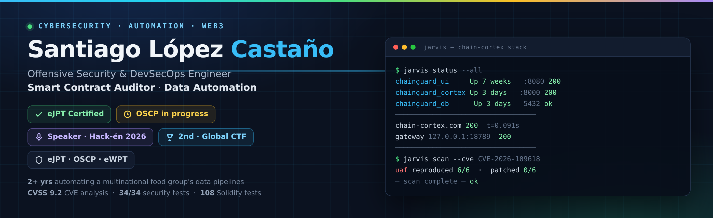
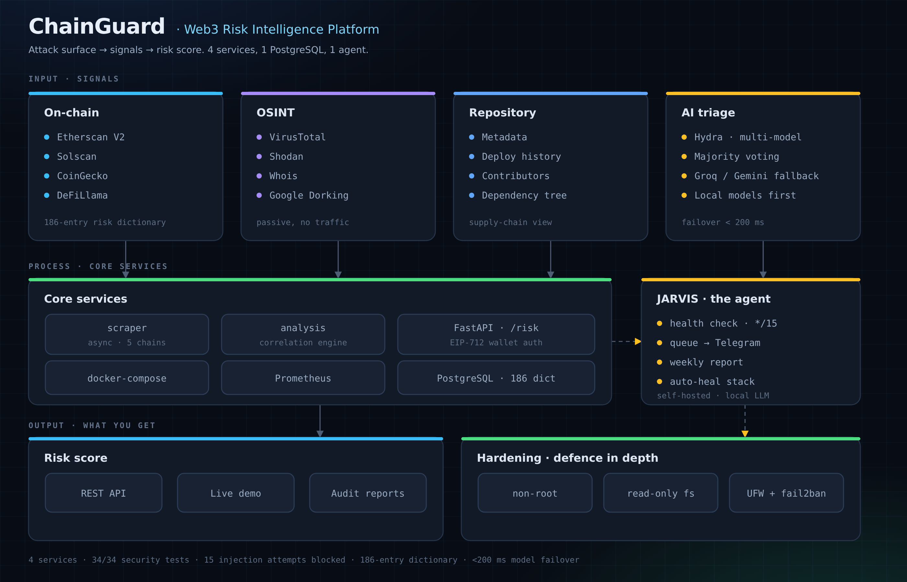
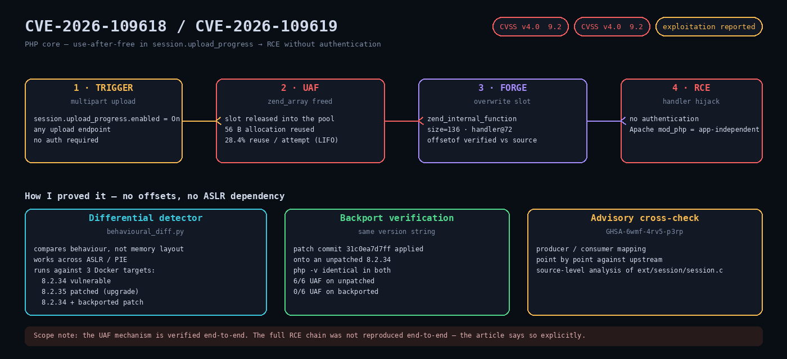
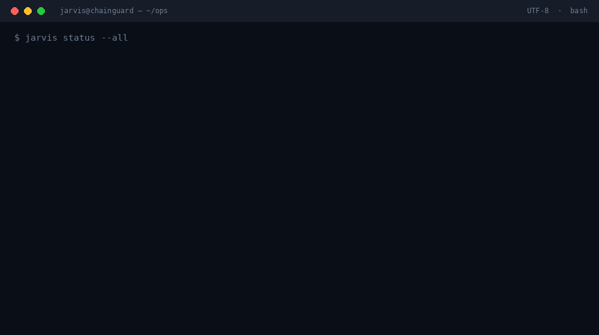
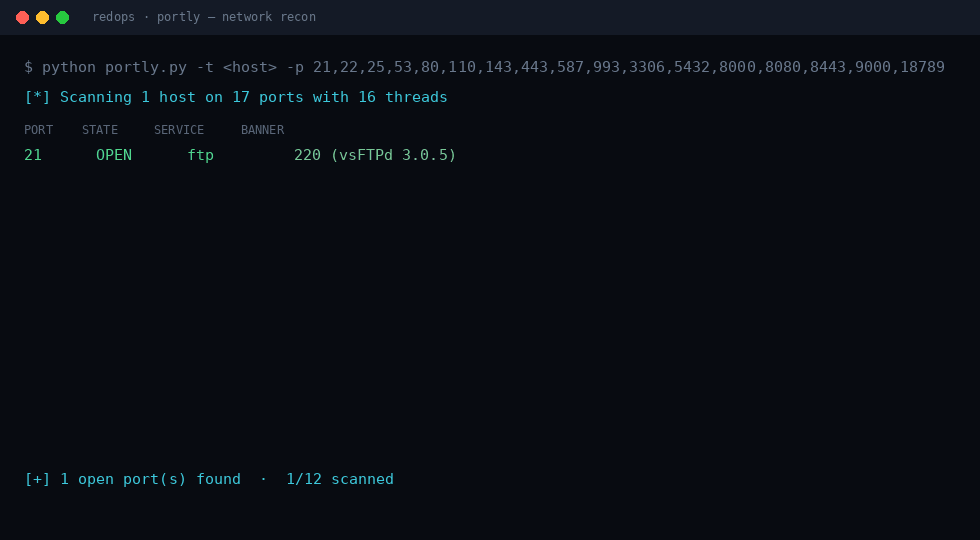
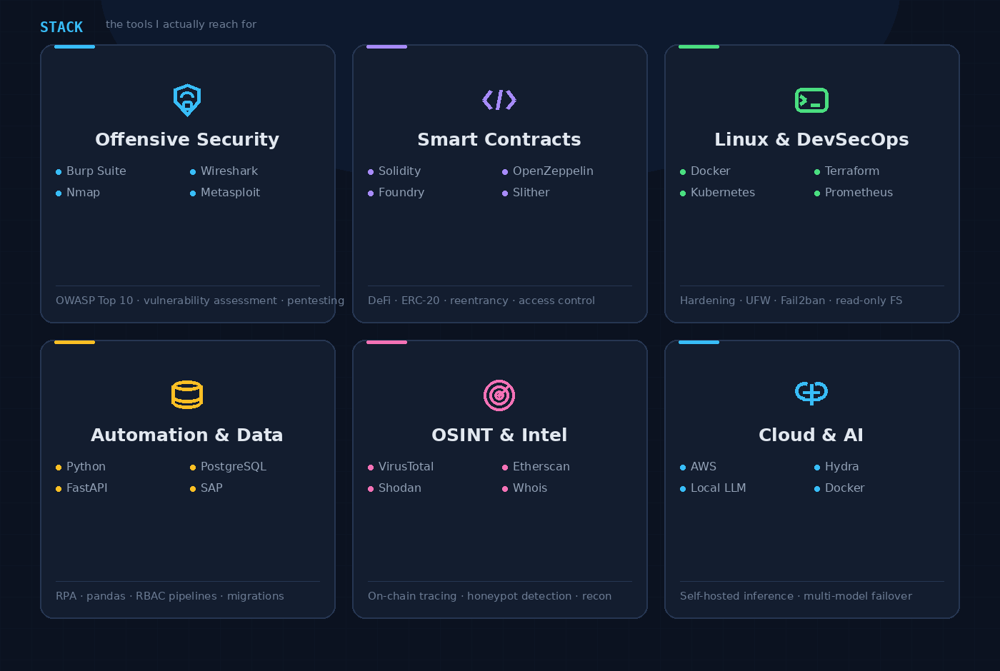

 

---

## 👋 Who I am

I break things for a living, then fix them properly.

2+ years automating a multinational food company's data pipelines by day. Offensive security, smart contract audits, and a self-hosted AI agent that refuses to send your data to someone else's cloud by night.

- **eJPT** certified · **OSCP** in progress (slowly, but going)
- Spoke at **Hack-én 2026** about Web3 vulnerabilities
- 2nd place in a global cybersecurity hackathon with 50+ teams
- Based in Spain, works remote, C1 English from 3 years of doing it in Finland at −25 °C

---

## 💼 Experience

**General Mills** — Data Architecture & Automation · San Adrián, Spain · *Oct 2024 – Present*
- Built a Python RPA script that automates data migration into SAP. Cut financial reporting from **5 hours to 40 minutes** and deleted the manual entry errors along the way.
- Moved Excel workflows into a centralized cloud environment with **role-based access control**. Cross-team productivity up 30%.
- Designed the database architecture behind the automated analytics. Report generation went from **2 hours to 5 minutes** (−95%).

**Chain-Cortex** — Open Source Builder & Project Lead · Remote · *Jan 2026 – Present*
- **Hydra** — an LLM orchestrator that runs on multiple models (OpenAI, Anthropic, Groq/Gemini fallback, local ones) and votes on the answer. Feeds it OSINT from Shodan, VirusTotal and Whois to triage vulnerabilities and hunt honeypots automatically.
- **ChainGuard** — a 4-service Docker platform for continuous vulnerability scanning. Also audited DeFi and ERC-20 contracts with Solidity and Foundry: **120+ tests**, **12+ exploit vectors** flagged (reentrancy, access control, the usual suspects).
- **Hardening** — locked down production Ubuntu VPS nodes and container workloads. Read-only filesystems, dropped capabilities, non-root execution, UFW and Fail2ban rules, Zero-Trust SSH channels.

**Wild About Lapland** — Operations & Customer Supervisor · Rovaniemi, Finland · *Oct 2021 – May 2024*
- Ran daily operations and incident response at −25 °C for **1,000+ international clients** every season. Kept customer satisfaction at **4.7/5**.
- Replaced "we'll figure it out" organization with a central database and actual SOPs.

---

## 🛡️ Projects

### ChainGuard — Web3 Risk Intelligence Platform

**[Repo](https://github.com/santilpz28/cortex)** · **[Live demo](https://santilpz28.github.io/chainguard-pages/)** · **[Live API](https://chain-cortex.com/)**

Scans Web3 domains, contracts and addresses, then merges on-chain signals, repo metadata and OSINT into one risk score.

| | |
|---|---|
| **4 services** | scraper · analysis · FastAPI · frontend |
| **34/34 security tests** | including 15 deliberate injection attempts (SQLi, XSS, SSTI, command injection, path traversal) |
| **186-entry dictionary** | 5 chains, 9 documented historical exploits |
| **Hydra orchestrator** | multi-model failover in <200 ms |
| **EIP-712 wallet auth** | no third-party custodian involved |

### PHP2Shell — Anatomy of two critical PHP CVEs

**[Repo (ES)](https://github.com/santilpz28/php2shell-pub)** · **[Repo (EN)](https://github.com/santilpz28/php2shell-pub-en)**

A use-after-free in PHP core that reaches RCE without authentication. I documented the whole thing, including a differential detector that works without offsets and doesn't care about ASLR.

- **3 local Docker targets** — vulnerable 8.2.34, patched 8.2.35, and 8.2.34 with the patch backported on top (same version string, because version strings are lies)
- **6/6 UAF reproduced** on the unpatched build, **0/6** on the patched one, measured against a real binary
- Cross-checked against advisory `GHSA-6wmf-4rv5-p3rp`

### JARVIS — the agent that runs it all

**[Repo](https://github.com/santilpz28/Jarvis)**

My own agent. Runs on local models so audit data never leaves the machine, wired to a hardened VPS over an encrypted Zero-Trust tunnel. Watches the stack, writes the reports, delivers them.

It also taught me the hard way that **a queue without a consumer is a silent black hole** — eight weeks of reports, zero delivered, nobody noticing. That lesson is now a health check.

### redops — Network Recon Toolkit

Small CLI tools for recon. Each one does a single job, none of them are obfuscated, none exceed 200 lines. The GIF above is a real scan — those banners came off the wire.

| Tool | What it does |
|---|---|
| `portly` | Multi-threaded port scanner — CIDR ranges, banner grab, JSON/CSV output |
| `subrecon` | Subdomain enumerator — crt.sh, wordlist, VirusTotal |
| `dirbust` | Web directory buster with status-code triage |

**[Repo](https://github.com/santilpz28/redops)**

---

## ⛓️ More projects

### Solidity Labs — Foundry

| Project | Scope | Tests |
|---|---|---|
| [master-lending-protocol](https://github.com/santilpz28/master-lending-protocol) | Non-custodial lending, collateral management, EIP-712 gasless auth, liquidations | 43/43 |
| [master-dao-governance](https://github.com/santilpz28/master-dao-governance) | On-chain DAO: proposals, voting, quorum, treasury | 27/27 |
| [master-staking-and-nft](https://github.com/santilpz28/master-staking-and-nft) | Staking pool + peer-to-peer NFT marketplace | 24/24 |
| [master-yield-farming](https://github.com/santilpz28/master-yield-farming) | Multi-pool yield farming with `abi.encodePacked` tricks | 14/14 |
| [foundry-fundme-f25](https://github.com/santilpz28/foundry-fundme-f25) | Security patterns — `tx.origin`, CEI, UUPS proxies | — |
| [ethernaut-foundry](https://github.com/santilpz28/ethernaut-foundry) | Ethernaut CTF levels, solved in Foundry | — |

### home-lab — Hardware & IoT Security

My hardware playground: Raspberry Pi 4B hardening, Pixhawk drone telemetry, Flipper Zero, MQTT over TLS, local AI inference.

[Repo](https://github.com/santilpz28/home-lab)

---

## 📝 Write-ups

**[Full write-ups →](https://santilpz28.github.io/chainguard-pages/#writeups)**

- **The Graph Protocol** — independent two-axis audit, scored **8.2/10**. Zero criticals, 10 real findings out of 1,606 raw Slither reports.
- **NavajaNegra 2025 (Caliphal Labs)** — MD5 truncated collision (brute-forcing a 5-character prefix) and a Reed-Solomon multi-sample recovery.
- **Hackademics Forum CTF 2025 (Daysa)** — MD5 length-extension attack that recovered a 52-byte secret in about 13K hash guesses.

---

## 🧰 Stack

| Area | Tools |
|---|---|
| **Offensive security** | Pentesting, OWASP Top 10, vulnerability assessment, Burp Suite, Nmap, Wireshark |
| **Web3 / Smart contracts** | Solidity, Foundry, OpenZeppelin, Slither, EIP-712, DeFi (lending, staking, DAO, yield farming) |
| **Linux & DevSecOps** | Ubuntu/RHEL, Docker, Kubernetes, Terraform, UFW, Fail2ban, SSH hardening, Prometheus |
| **Automation & Data** | Python (FastAPI, pandas), SQL (PostgreSQL, MySQL), SAP, RPA, RBAC |
| **OSINT & Threat intel** | VirusTotal, Shodan, Whois, Etherscan, on-chain tracing, n8n |
| **Cloud & AI** | AWS, self-hosted LLM inference, multi-model orchestration |

---

## 🎓 Education

**Higher Technician in IT Systems & Networks (ASIR)** — Cybersecurity specialization · The Power, Remote · *Sept 2024 – Jun 2026*

**Ethereum Development & Web3 Security** — Blockchain Accelerator, Remote · *Sept 2025 – May 2026*

**Business Administration** — Loyola Andalucía, Córdoba · *2017 – 2021*
Erasmus — Lapland AMK, Rovaniemi, Finland · *Jan – May 2021*

---

## 🏅 Certifications

**eJPT** — Junior Penetration Tester (eLearnSecurity)
**OSCP** — in progress

---

## 📬 Contact

**Phone:** +34 613 20 6565
**Languages:** Spanish (native) · English (C1) · Russian (A2)

---

*Open to Cybersecurity, Web3 Security (Solidity auditing) and Linux/DevSecOps roles.*
*Remote-first from CET, happy to relocate within EU or Switzerland.*

